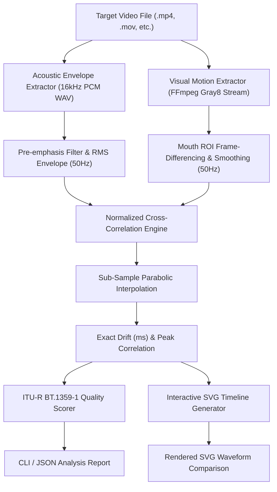

[🇸🇦 العربية](README.ar.md) | [🇬🇧 English](README.md)

# 👄 eidcloud-lipsync-analyzer

[](https://github.com/eidcloud/eidcloud-lipsync-analyzer/releases)
[](https://www.php.net)
[](LICENSE)
[](https://colab.research.google.com/github/eidcloud/eidcloud-lipsync-analyzer/blob/main/notebooks/quickstart.ipynb)
[](https://github.com/eidcloud/eidcloud-lipsync-analyzer/actions)

> **Audio-video lip-sync quality and timing alignment analyzer measuring drift and sync scores in pure PHP 8.2+ with FFmpeg integration.**

---

## 🎯 Architecture & Processing Pipeline



---

## 🚀 Key Features

- **Pure DSP Energy Envelope Extraction**: Decodes audio tracks into calibrated 16kHz PCM mono streams, calculates pre-emphasized RMS energy envelopes with consonant/formant amplification.
- **Visual Mouth Motion Vector Analysis**: Inspects lower-face visual ROIs (Region of Interest) across video frames using streaming grayscale differences to capture articulation events.
- **Sub-Sample Cross-Correlation**: Computes cross-correlation coefficients across a temporal lag search window, applying parabolic peak interpolation for sub-millisecond drift precision.
- **ITU-R BT.1359-1 & ATSC IS-191 Standards**: Classifies AV timing into standardized quality categories:
  - `Perfect` (<= 25ms drift)
  - `Acceptable` (<= 75ms drift)
  - `Noticeable Delay` (<= 150ms drift)
  - `Desynchronized` (> 150ms drift)
- **High-Definition SVG Timeline**: Generates sleek, glow-styled SVG comparison waveforms plotting audio speech envelope peaks against visual mouth articulation pulses.
- **Zero Heavy PHP Dependencies**: Requires only PHP 8.2+ and system FFmpeg; zero composer vendor bloat.

---

## 📦 Installation

### Option 1: Via Composer

```bash
composer require eidcloud/lipsync-analyzer
```

### Option 2: Clone Directly

```bash
git clone https://github.com/eidcloud/eidcloud-lipsync-analyzer.git
cd eidcloud-lipsync-analyzer
chmod +x bin/eidcloud-lipsync
```

*Requirements:*
- PHP `>= 8.2`
- FFmpeg installed and accessible in your system `PATH`

---

## 💻 CLI Usage

### 1. Analyze Video Lip-Sync Alignment

```bash
php bin/eidcloud-lipsync analyze interview.mp4
```

*Output Example:*
```text
=========================================================
👄 EidCloud Lip-Sync Alignment Analysis
=========================================================
 File:              interview.mp4
 Duration Analyzed: 12.40 seconds (620 samples)
 Sampling Rate:     50.0 Hz (20.0 ms window)
---------------------------------------------------------
 Sync Drift:        +22.40 ms (+0.0224 sec)
 Status Category:   Perfect
 Quality Score:     96.2 / 100%
 Correlation Peak:  0.9412
=========================================================
```

### 2. JSON Output for Automated Pipelines

```bash
php bin/eidcloud-lipsync analyze interview.mp4 --json
```

```json
{
  "drift_ms": 22.4,
  "drift_seconds": 0.0224,
  "sync_score": 96.2,
  "category": "Perfect",
  "correlation_peak": 0.9412,
  "sample_rate_hz": 50,
  "duration_seconds": 12.4,
  "envelope_samples": 620,
  "metadata": {
    "file": "interview.mp4",
    "filesize": 15420310,
    "samples_analyzed": 620
  }
}
```

### 3. Generate SVG Waveform Timeline

```bash
php bin/eidcloud-lipsync timeline interview.mp4 --out=alignment.svg
```

---

## 🛠️ PHP API Usage

```php
use EidCloud\LipsyncAnalyzer\LipsyncAnalyzer;

$analyzer = new LipsyncAnalyzer();

// 1. Analyze drift and quality score
$result = $analyzer->analyze('speech.mp4', samplingRateHz: 50.0);

echo "Drift: {$result->driftMs} ms\n";
echo "Score: {$result->score}%\n";
echo "Category: {$result->category}\n";

// 2. Render SVG timeline
$svgString = $analyzer->generateTimeline('speech.mp4', 'output_timeline.svg');
```

---

## 🧪 Testing

Run the zero-dependency test suite:

```bash
php tests/run_tests.php
```

---

## 📓 Google Colab Notebook

Experiment live in your browser without local installation:
[](https://colab.research.google.com/github/eidcloud/eidcloud-lipsync-analyzer/blob/main/notebooks/quickstart.ipynb)

---

## 👤 Author & Maintainer

**Eng. MHD. Shadi AL-Hasan**  
- **Role:** Executive CTO & Enterprise Solutions Architect  
- **Email:** [mhd.shadi.alhasan@gmail.com](mailto:mhd.shadi.alhasan@gmail.com)  
- **Phone / WhatsApp:** [+963934005922](tel:+963934005922)  
- **Location:** Damascus, Syria  
- **GitHub:** [shadialhasan](https://github.com/shadialhasan)  

---

## 📄 License

This project is licensed under the MIT License - see the [LICENSE](LICENSE) file for details.  
Copyright (c) 2026 **MHD. Shadi AL-Hasan**. All rights reserved.
